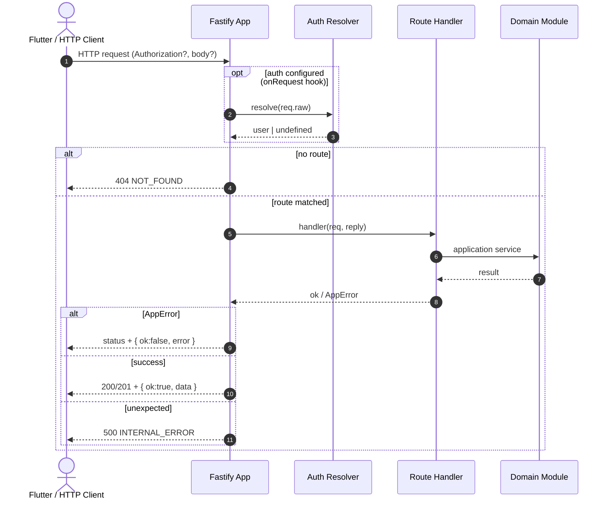
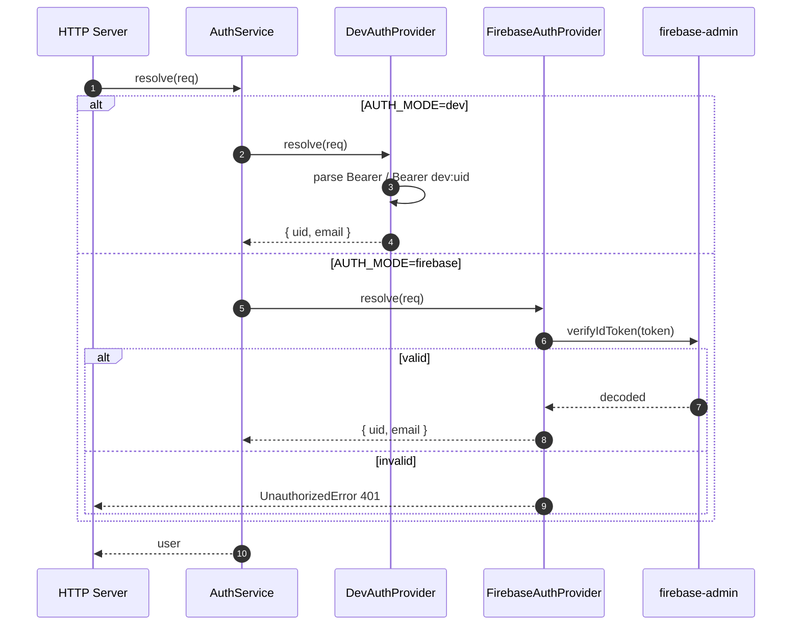
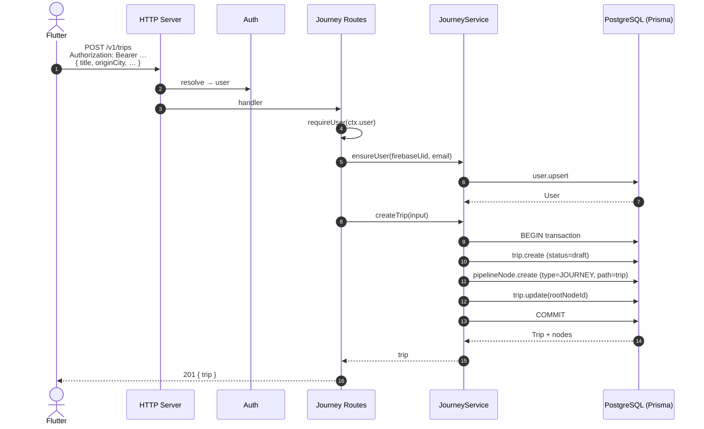
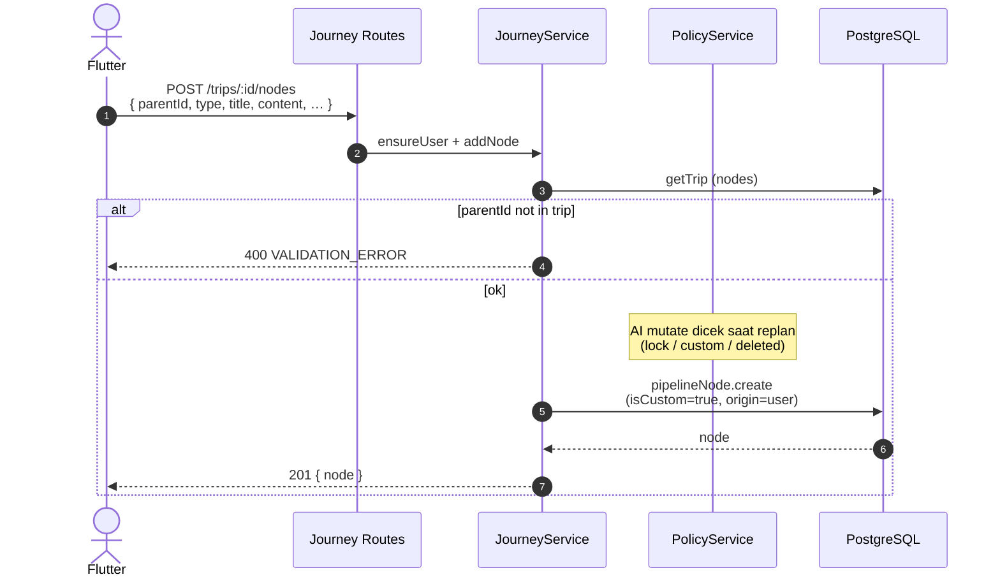
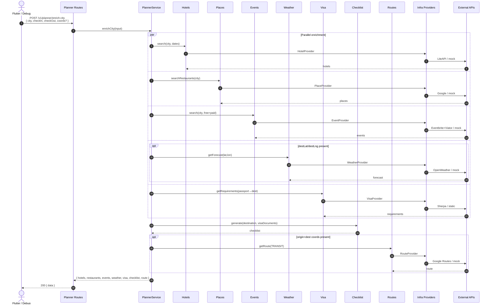
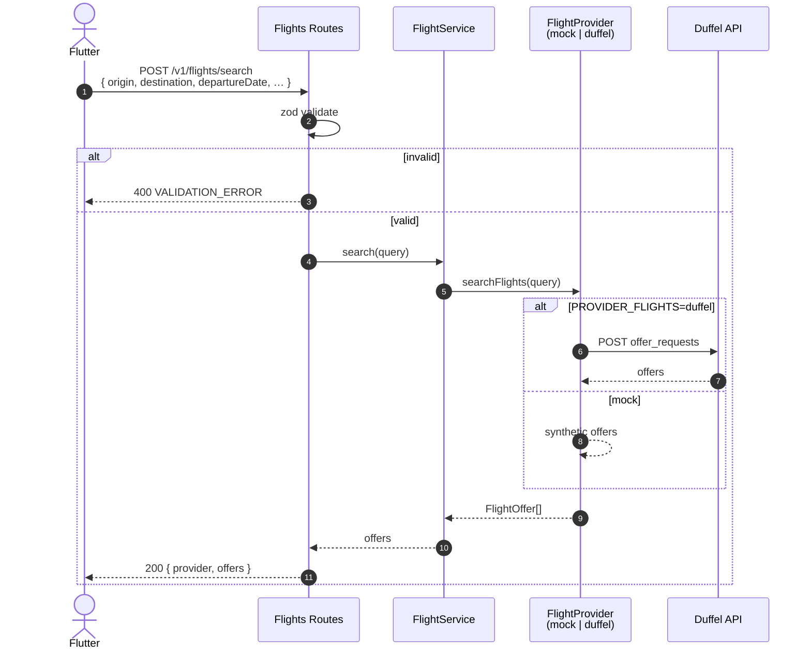
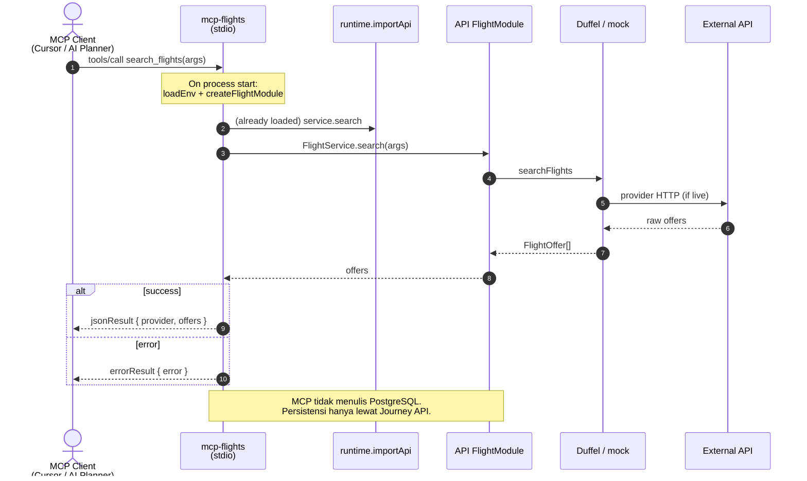
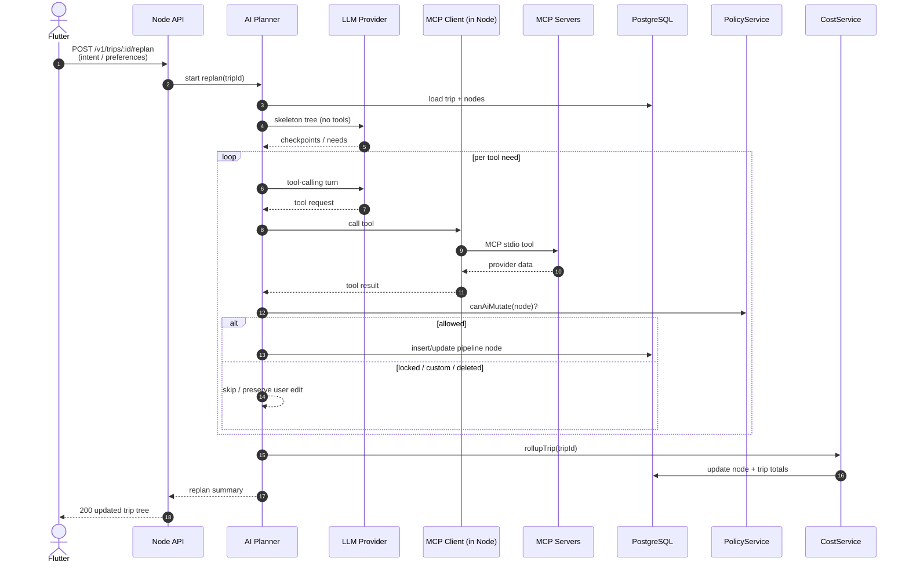
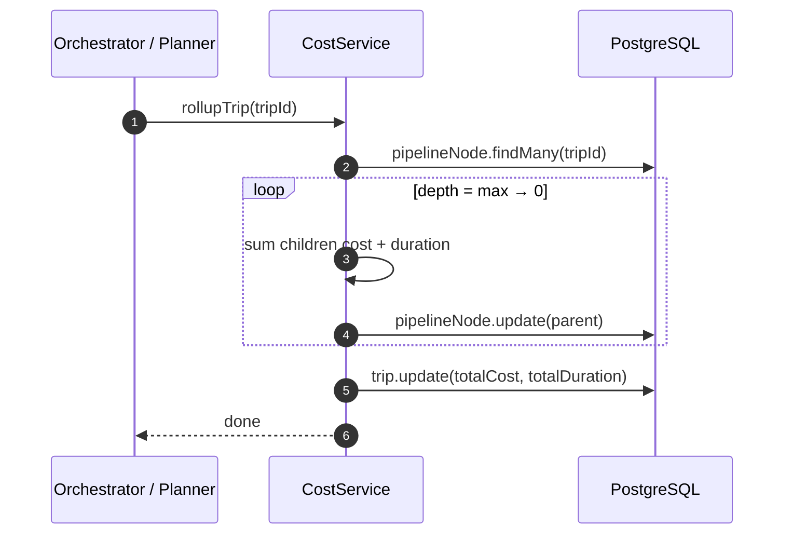

# Traverior — Sequence Diagrams (Backend)

Diagram urutan untuk alur backend yang sudah diimplementasi (modular monolith API + MCP).  
Render Mermaid di GitHub / VS Code / [mermaid.live](https://mermaid.live).

---

## 0. Ringkasan aktor

| Aktor | Peran |
|--------|--------|
| **Flutter** | Client mobile; HTTPS + Firebase / Dev token |
| **HTTP Server** | Fastify (`shared/http/app`) |
| **Auth** | Dev / Firebase provider |
| **Domain modules** | Flights, Hotels, Places, Routes, Weather, Events, Visa, Checklist, Journey, Planner, Cost, Policy |
| **Prisma / PostgreSQL** | Persistensi trip + pipeline tree |
| **MCP Client** | (Target) AI Planner memanggil tools via MCP |
| **MCP Server** | Connector stdio per domain; reuse API providers |
| **External APIs** | Duffel, LiteAPI, Google, OpenWeather, Eventbrite, Viator, Sherpa, … |

---

## 1. Lifecycle request HTTP (semua `/v1/*`)

---

## 2. Auth resolve (Dev vs Firebase)

---

## 3. Buat trip + root pipeline node

`POST /v1/trips` — Flutter membuat journey baru.

---

## 4. Tambah node kustom ke pipeline

`POST /v1/trips/:tripId/nodes`

---

## 5. Enrich city (Planner MVP — in-process)

`POST /v1/planner/enrich-city`  
Phase 1: Planner memanggil **application services langsung** (bukan MCP). MCP path = target fase berikutnya.

---

## 6. Search flights via HTTP API

`POST /v1/flights/search`

---

## 7. MCP tool call — search_flights (stdio)

Alur connector: MCP client (Cursor / future AI Planner) → MCP server → API provider module.

---

## 8. Target end-to-end: AI replan via MCP (fase berikutnya)

Sesuai `docs/03-architecture-tools.md` — Flutter tidak panggil LLM/MCP langsung.

---

## 9. Cost roll-up

---

## 10. Peta alur → endpoint / tool

| Sequence | Trigger |
|----------|---------|
| §1 HTTP lifecycle | Semua request |
| §2 Auth | Header `Authorization` |
| §3 Create trip | `POST /v1/trips` |
| §4 Add node | `POST /v1/trips/:id/nodes` |
| §5 Enrich city | `POST /v1/planner/enrich-city` |
| §6 Flight search HTTP | `POST /v1/flights/search` |
| §7 MCP flights | MCP tool `search_flights` |
| §8 AI replan (target) | Belum di-wire LLM |
| §9 Cost roll-up | Dipanggil setelah mutate tree |

Gambar ringkas alur utama (enrich + persist target):  
[`traverior-backend-sequence-overview.png`](./traverior-backend-sequence-overview.png)
