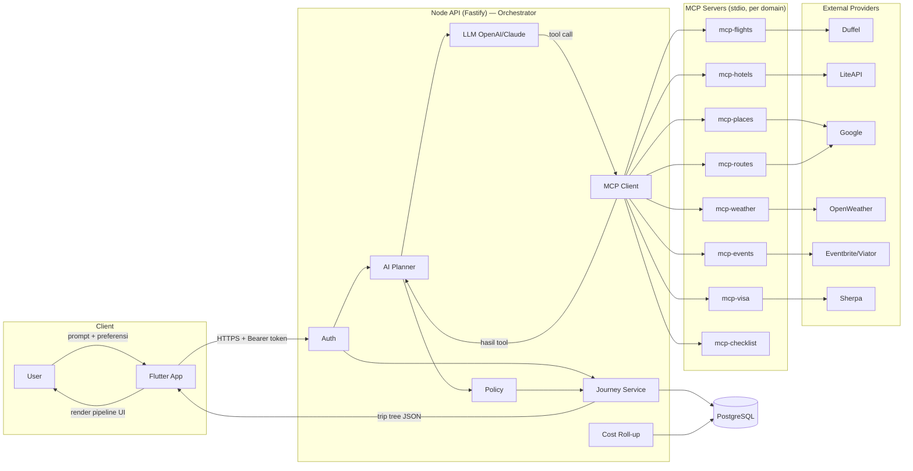
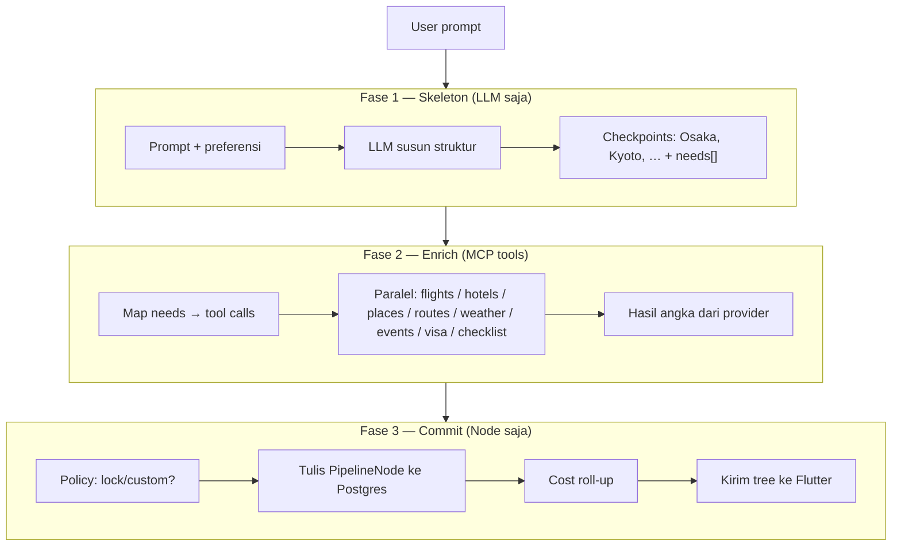
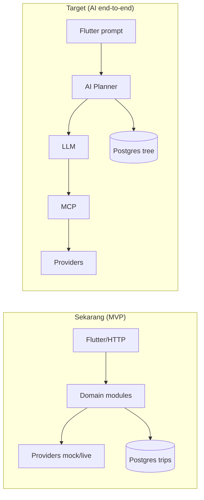

# Traverior — End-to-End Flow (UI → LLM → MCP → Backend → DB)

Dokumen ini menjelaskan **siapa memanggil siapa**, **request/response**, dan **data apa yang bergerak** dari user pertama kali mengetik prompt sampai journey tersimpan di database.

> **Aturan emas (jangan dilupakan)**  
> 1. Flutter **hanya** bicara ke **Node API** (HTTPS).  
> 2. Flutter **tidak** memanggil LLM atau MCP.  
> 3. LLM hidup **di dalam** AI Planner (Node API).  
> 4. MCP = jembatan tool → provider eksternal (Duffel, LiteAPI, …).  
> 5. **Hanya Node API** yang menulis PostgreSQL. MCP **stateless** (tidak simpan trip).

---

## 1. Big picture (satu layar)



---

## 2. Alur waktu lengkap (target produk)

Ini alur **yang dituju** saat user pertama kali prompt, misalnya:

> *“Rencanakan trip Jakarta → Osaka 3 hari, budget menengah, suka makan street food.”*

```mermaid
sequenceDiagram
  autonumber
  actor User as User
  participant UI as Flutter UI
  participant API as Node API<br/>(Fastify)
  participant Auth as Auth
  participant Plan as AI Planner
  participant LLM as LLM
  participant MCP as MCP Client + Servers
  participant Prov as External APIs
  participant Pol as Policy
  participant Cost as Cost Service
  participant DB as PostgreSQL

  %% --- Login / session ---
  User->>UI: Buka app / login
  UI->>UI: Firebase Auth → ID token
  Note over UI,API: Semua request berikutnya<br/>Authorization: Bearer &lt;token&gt;

  %% --- Prompt ---
  User->>UI: Ketik prompt + preferensi
  UI->>API: POST /v1/trips/:id/plan<br/>{ prompt, preferences }
  API->>Auth: verify token → { uid, email }
  Auth->>DB: upsert User (jika baru)
  API->>DB: load / create Trip + root JOURNEY node

  %% --- Fase 1: skeleton ---
  API->>Plan: startPlan(tripId, prompt)
  Plan->>DB: baca trip context + preferensi
  Plan->>LLM: system + user prompt<br/>(tanpa tools)
  LLM-->>Plan: skeleton checkpoints<br/>{ Osaka STAY 3d, needs:[flights,hotels,…] }

  %% --- Fase 2: tools via MCP ---
  loop untuk setiap need (bisa paralel)
    Plan->>LLM: turn dengan tool schemas
    LLM-->>Plan: minta tool (mis. search_flights)
    Plan->>MCP: call tool(args)
    MCP->>Prov: HTTP ke Duffel / LiteAPI / …
    Prov-->>MCP: data mentah (harga, jadwal, …)
    MCP-->>Plan: hasil ternormalisasi
    Note over Plan,LLM: Angka harga/waktu<br/>hanya dari tool, bukan dikarang LLM
  end

  %% --- Fase 3: persist ---
  Plan->>Pol: boleh AI ubah node ini?
  alt node unlocked
    Plan->>DB: insert/update PipelineNode<br/>(origin=ai)
  else locked / custom user
    Plan-->>Plan: skip / preserve edit user
  end

  Plan->>Cost: rollupTrip(tripId)
  Cost->>DB: update cost/duration per node + total trip

  %% --- Response ke UI ---
  Plan-->>API: trip tree + ringkasan
  API-->>UI: 200 { ok:true, data: { trip, nodes, totals } }
  UI-->>User: Tampilkan Journey Pipeline<br/>(macro → drill-down)
```

---

## 3. Data flow — apa yang dikirim di tiap hop

| Langkah | Dari → Ke | Payload (inti) | Response |
|---------|-----------|----------------|----------|
| Login | Flutter → Firebase | email/password / social | `idToken` |
| Prompt plan | Flutter → API | `Authorization`, `{ prompt, dates, budget, pace, partySize }` | `{ tripId, status: planning }` atau tree lengkap |
| Auth | API → Firebase Admin / Dev | Bearer token | `{ uid, email }` |
| User sync | API → DB | `firebaseUid`, email | `User.id` |
| Skeleton | Planner → LLM | prompt + preferensi + context trip | JSON checkpoints + `needs[]` |
| Tool call | Planner → MCP → Provider | args tipikal: origin/dest/dates/pax/city | offers / hotels / routes / forecast / … |
| Persist | Planner → DB | `PipelineNode` (type, title, content, cost, origin=`ai`) | node ids |
| Cost | Cost → DB | sum children → parent | `totalCost`, `totalDuration` |
| Render | API → Flutter | tree nodes (path, depth, children) | UI pipeline rekursif |

### Bentuk data penting di DB

```
User 1──* Trip 1──* PipelineNode (tree via parentId)
                       │
                       ├── content JSON (flight/hotel/poi/…)
                       ├── costAmount / costCurrency
                       ├── origin: ai | user | api
                       ├── isLocked / isCustom
                       └── path: "trip/osaka/day1/…"
```

---

## 4. Tiga fase AI Planner (detail)



Contoh mapping `needs` → MCP:

| `needs` | MCP Server | Tool | Provider |
|---------|------------|------|----------|
| flights | `mcp-flights` | `search_flights` | Duffel |
| hotels | `mcp-hotels` | `search_hotels` | LiteAPI |
| places | `mcp-places` | `search_restaurants` / POI | Google Places |
| routes | `mcp-routes` | `get_route` | Google Routes |
| weather | `mcp-weather` | `get_forecast` | OpenWeather |
| events | `mcp-events` | `search_events` / `search_tours` | Eventbrite + Viator |
| visa | `mcp-visa` | `get_visa_requirements` | Sherpa |
| checklist | `mcp-checklist` | `generate_checklist` | Internal + visa docs |

---

## 5. Request / response envelope API

Semua HTTP response Traverior memakai bentuk:

**Sukses**
```json
{ "ok": true, "data": { /* … */ } }
```

**Gagal**
```json
{ "ok": false, "error": { "code": "VALIDATION_ERROR", "message": "…" } }
```

Auth di setiap request terproteksi:

```http
Authorization: Bearer <Firebase ID token>
# atau mode dev:
Authorization: Bearer dev:demo-user
```

---

## 6. Apa yang sudah jalan vs target

| Bagian | Status sekarang | Target |
|--------|-----------------|--------|
| Flutter → Fastify API | ✅ endpoint domain siap | UI full journey chat |
| Auth Dev / Firebase | ✅ | ✅ |
| Trip + PipelineNode di Postgres | ✅ CRUD | + replan / snapshot |
| Domain services (flights, hotels, …) | ✅ mock + live adapters | ✅ |
| MCP servers per domain | ✅ stdio tools | dipanggil dari Planner |
| AI Planner `enrichCity` | ✅ deterministic (tanpa LLM) | + LLM skeleton + tool-calling |
| LLM di dalam API | ❌ belum di-wire | OpenAI / Claude |
| `POST …/plan` atau `/replan` penuh | ❌ | endpoint orchestrated |

**Hari ini (MVP teknis):** Flutter/HTTP bisa memanggil modul langsung, mis. `POST /v1/flights/search` atau `POST /v1/planner/enrich-city` — **tanpa** LLM.  
**Target:** satu prompt di UI → AI Planner orkestrasi LLM + MCP → simpan tree → UI render.



---

## 7. Analogi singkat

| Peran | Analogi |
|-------|---------|
| Flutter | Layar & keyboard user |
| Node API | Manajer perjalanan |
| LLM | Otak yang menyusun rencana |
| MCP | Telepon ke vendor (maskapai, hotel, …) |
| Provider API | Vendor itu sendiri |
| PostgreSQL | Binder trip yang disimpan |
| Policy / Cost | Aturan “jangan timpa edit user” + kalkulator total |

---

## 8. Bacaan lanjutan

- Arsitektur tools MCP: [03-architecture-tools.md](./03-architecture-tools.md)
- Model pipeline tree: [02-pipeline-model.md](./02-pipeline-model.md)
- Sequence detail per endpoint: [13-sequence-diagrams.md](./13-sequence-diagrams.md)
- Database: [11-database-design.md](./11-database-design.md)
